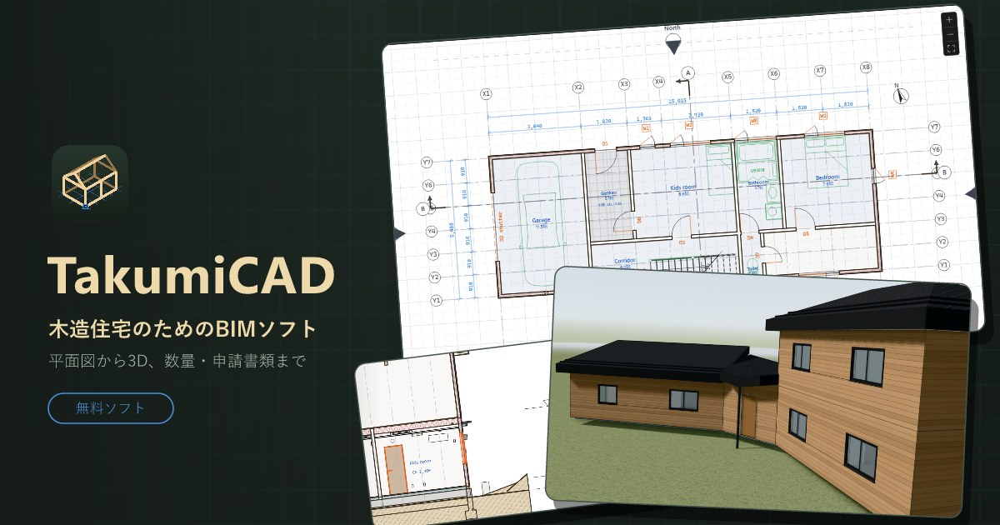
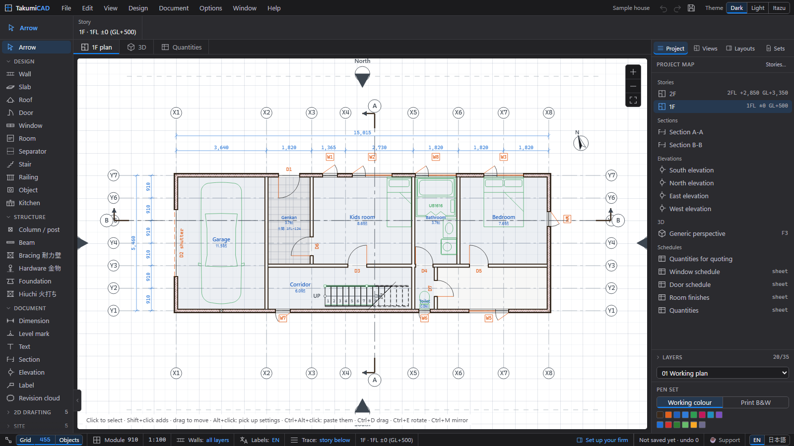
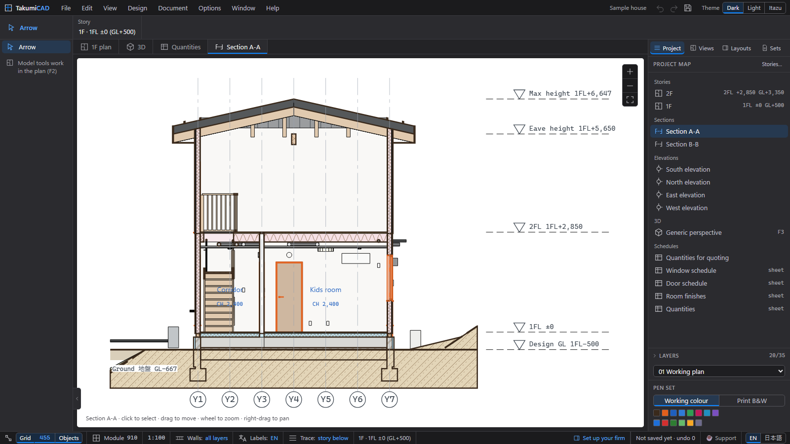
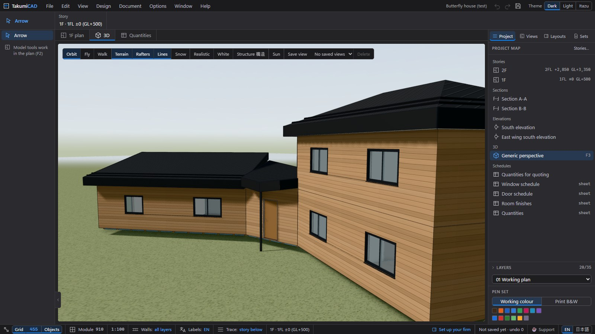

# SumiCAD (墨CAD)

**BIM software for Japanese timber houses (在来軸組).** Draw the model once — plans, sections, elevations, structure checks, MEP, kitchens, quantities and permit documents all come from that one model.

日本の木造住宅のための BIM ソフト。モデルをひとつ作れば、平面図・立面図・断面図、壁量計算、設備図、キッチン、数量・見積、確認申請図書まで、すべてそこから作成できます。

**[⬇ Download the latest release / 最新版をダウンロード (free / 無料)](https://github.com/sumicad/sumicad-releases/releases/latest)** — Windows 10/11 64-bit

## What it does / できること

- **One model, every drawing** — floor plans, sections, elevations and 3D stay in sync; move a wall and every view updates.
  モデル一元管理 — 平面・断面・立面・3D が連動し、壁を動かせば全図面に反映されます。
- **Japanese timber construction built in** — 在来軸組 walls with real build-ups (posts, OSB, insulation, plasterboard, siding), 910 mm grid, heights from GL, foundations, roof and eaves per side.
  日本の木造に特化 — 柱・OSB・断熱・石膏ボード・外壁の実構成の壁、910 グリッド、GL 基準の高さ、基礎、屋根・軒の設定。
- **Structure checks** — wall quantity checks (壁量計算) per story and direction.
  構造チェック — 階・方向ごとの壁量計算。
- **Permit documents** — site plan, area tables, daylight / ventilation and the 確認申請 drawing set, print-ready PDF at true scale.
  確認申請図書 — 配置図、面積表、採光・換気計算、確認申請図面一式を実尺度の PDF で出力。
- **Maker catalogues at true scale** — LIXIL, YKK AP windows and doors, unit baths, kitchens.
  メーカー図鑑から実寸法で — LIXIL・YKK AP のサッシ・ドア、ユニットバス、キッチン。
- **Quantities and estimates** — bill of quantities from the model for quoting.
  数量・見積 — モデルから数量を拾い、見積に活用。
- **Familiar workflow** — Archicad-style toolbox, navigator, stories, layers, pen sets; DXF / PDF output (JWW in progress).
  慣れた操作感 — Archicad 風のツールボックス・ナビゲーター・階設定・レイヤー・ペンセット。DXF / PDF 出力（JWW は準備中）。

## User guide / 使い方ガイド

📖 **The user guide is being written right now on the [Wiki](https://github.com/sumicad/sumicad-releases/wiki)** (English and 日本語). Pages appear as they are finished — check back soon.

使い方ガイドを [Wiki](https://github.com/sumicad/sumicad-releases/wiki) で作成中です（英語・日本語）。完成したページから順に公開します。しばらくお待ちください。

What is planned next is in the [roadmap](ROADMAP.md).
今後の予定は [ロードマップ](ROADMAP.md) にあります。

## Free, in testing, and you can help / 無料・テスト中・応援のお願い

SumiCAD is **free software** and is currently **being tested** — expect rough edges, and please tell us what breaks: [GitHub Issues](https://github.com/sumicad/sumicad-releases/issues).

SumiCAD は**無料ソフト**です。現在**テスト中**のため、不具合や粗い部分があります。[Issues](https://github.com/sumicad/sumicad-releases/issues) でぜひお知らせください。

If SumiCAD helps your work, you can support its development here:
開発を応援していただける方はこちらから:

**❤ [ofuse.me/sumicad](https://ofuse.me/sumicad)**

---

Free software, provided as is, without warranty. Permit, structural and energy documents must be checked, signed and submitted by a licensed architect (建築士).

無償のソフトウェアです（現状有姿・無保証）。確認申請・構造・省エネの図書は、必ず建築士が確認・記名のうえ提出してください。
